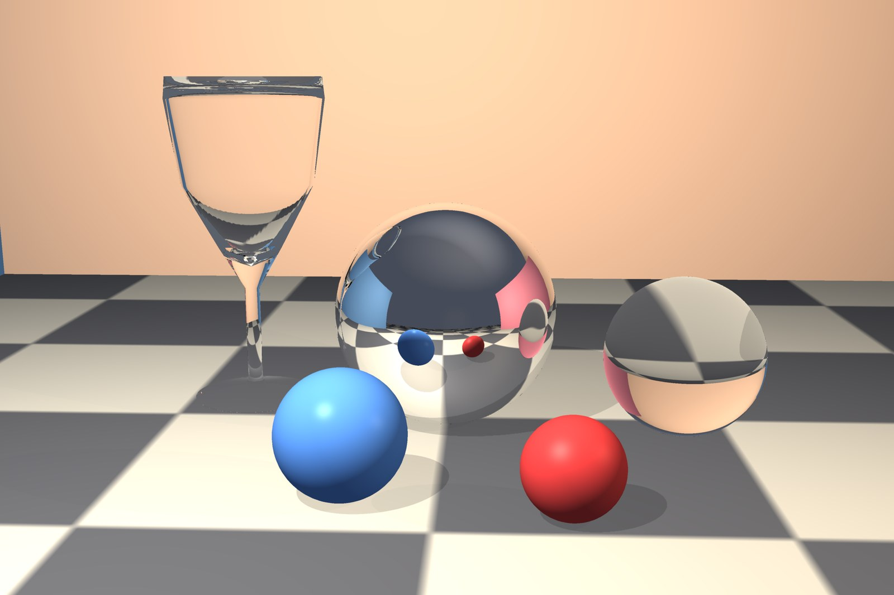
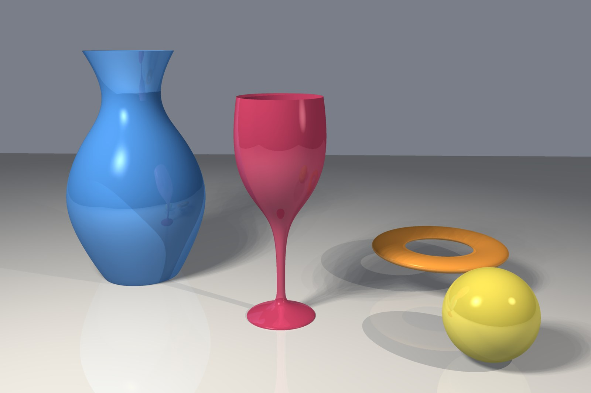

# Fogle3D

> **Legal notice.** Fogle3D is an unofficial, independent project. It is not affiliated with, endorsed by or
> connected to the makers or owners of Softimage 3D. It needs **your own licensed copy of Softimage 3D 4.0**, and it
> ships none of that product's files, assets or code: no program, library, database, resource, shader, font, picture
> or texture of it is in this repository or in the add-on's zip. See [NOTICE.md](NOTICE.md).

> **Vibe-coded.** Fogle3D is a vibe-coded project: it was written almost entirely by AI coding agents (Claude, by
> Anthropic), directed by its owner, who is not a professional programmer. People did not read or review most of the
> code line by line. It is checked by automated tests and by comparing its pictures with the original program's
> pictures, not by human code review, and it may contain mistakes, rough edges and unfinished parts. Use it at your
> own risk, and please report problems as issues.

Fogle3D is a render engine for Blender. Its renderer is a reimplementation, in Rust, of the renderer of Softimage 3D
4.0 (the Linux version of the program), written to give the same pictures. The Blender add-on renders the open
Blender scene with it (Render Properties > Render Engine > Fogle3D) and imports Softimage 3D scene files
(File > Import > Softimage 3D scene (.dsc)). The renderer is a separate program the add-on starts, so it also runs
on its own from the command line.

## Pictures

Both pictures were rendered by Fogle3D from Blender scenes built from scratch for this page (our own geometry and
generated textures; nothing from Softimage 3D's sample content). Settings and times are as measured on a 22-core Linux
machine, 1920x1280 render, shown here at 1600 px.



*Glass and metal still life: a wine glass and a ball in refracting glass, a chrome ball, two painted balls, on a
generated checker floor in a room. Ray traced reflection and refraction (depth 8), hard ray traced shadows from the
lights (the area light is rendered as a spot, so no soft shadows), no anti-aliasing settings changed. Fogle3D 2.5 s;
the same scene in Blender Cycles, CPU, 128 samples, no denoising, took 86.6 s and shows soft shadows and glossy
highlights that Fogle3D does not.*



*NURBS surfaces: a vase and a wine glass (surfaces of revolution, cubic NURBS), a torus and a sphere patch, with ray
traced shadows. Fogle3D 5.8 s at 1920x1280; Blender Cycles, CPU, 128 samples, no denoising, 19.4 s. Fogle3D's
picture is flatter: no soft shadows and no glossy highlights beyond a simple specular.*

## What is here

| Path | What it is |
|---|---|
| `crates/` | the engine: one Rust crate per part of the original program (`si-render` the renderer, `si-db` the scene database, `si-anim` animation, `si-nurbs`, `si-mental`, ...) |
| `re/tools/si-render/pictures/` | `render-frames`, the renderer program the add-on runs (its own Cargo workspace) |
| `re/tools/builder2/blend2db/` | `blend2db`, which turns a Blender scene into a database `render-frames` reads |
| `re/tools/import1/` | `si-import-dump`, the reader of `.dsc` scenes behind File > Import |
| `re/tools/pkg/si-install/` | finds your install and checks that it holds the files the programs read |
| `re/tools/pkg/check_bundle.sh` | builds the add-on zip and fails if any file or part of a file of an install ended up in it |
| `blender-addon/softimage3d/` | the Blender add-on (installed as the extension `fogle3d`); `blender-addon/tests/` its tests |
| `docs/` | what the programs read from the install, design notes, measurements, and descriptions of the original's file formats and subsystems in our own words |

Comments in the engine cite the function of the original program a piece of code reimplements, by its address in the
Linux program, for example `[soft 0x08123456 name]`. They are references for checking the port, not copies of code.

## What you need

- Linux on x86-64 (the add-on's platform is `linux-x64`).
- A stable Rust toolchain with Cargo (the crates use edition 2021; this tree is built and checked with Rust 1.93).
- Blender 4.2 or newer.
- Your own installed copy of Softimage 3D 4.0: the directory it was installed to, the one that holds `Creative-Rsrc/`.
  The programs read the files they need from it at run time; [docs/install-requirements.md](docs/install-requirements.md)
  lists them. Nothing is copied out of it into a build.

## Build the engine

From the root of this repository:

```
cargo build --release --manifest-path re/tools/si-render/pictures/Cargo.toml --bin render-frames
cargo build --release --manifest-path re/tools/builder2/blend2db/Cargo.toml
cargo build --release --manifest-path re/tools/import1/Cargo.toml
```

Each is its own Cargo workspace; the programs land in `re/tools/si-render/pictures/target/release/render-frames`,
`re/tools/builder2/blend2db/target/release/blend2db` and `re/tools/import1/target/release/si-import-dump` (or under
`$CARGO_TARGET_DIR/release` if you set it). The engine's crates build on their own with `cargo build --workspace` from
the root. The renderer uses the processor's x87 unit on x86-64; `SI_X87=soft` at build time selects
the software model of it instead (the same pictures, slower).

## Build and install the add-on

```
SI_INSTALL=/path/to/your/softimage3d re/tools/pkg/check_bundle.sh --out dist
```

This builds the three programs, stages the add-on as `fogle3d/` with them in `fogle3d/bin/`, writes
`dist/fogle3d-addon.zip`, and then checks the staged files and every member of the zip against your install: it fails
if any file name, file or 64-byte part of a key file of the install is inside. `SI_INSTALL` (or `--install DIR`) is
only used for that comparison; without an install the check fails unless you pass `--allow-no-install`.
`--no-build --bin-dir DIR` uses programs you built yourself.

In Blender: Edit > Preferences > Get Extensions > Install from Disk, and choose `dist/fogle3d-addon.zip`. Then in
Edit > Preferences > Add-ons > Fogle3D set **Softimage 3D 4.0 install path** to your install (the directory that holds
`Creative-Rsrc/`). The environment variable `SI_INSTALL`, if set, wins over the preference, and a scene's own
"Install dir" field (Render Properties > Fogle3D) wins over both. If the path is missing or
lacks a needed file, the preferences panel and the render's error text name the missing file.

Set the render engine to **Fogle3D** and render (F12). The programs inside the zip are used unless the add-on's
preferences name others. More on the preferences, the per-scene settings and the import:
[blender-addon/README.md](blender-addon/README.md).

## Licence

- The engine and the programs (everything outside `blender-addon/`): **MIT**, see [LICENSE](LICENSE).
- The Blender add-on (`blender-addon/`): **GPL-3.0-or-later**, see
  [blender-addon/softimage3d/LICENSE](blender-addon/softimage3d/LICENSE). Blender requires this for add-ons that use
  its Python API.
- Third-party notices and trademarks: [NOTICE.md](NOTICE.md).
